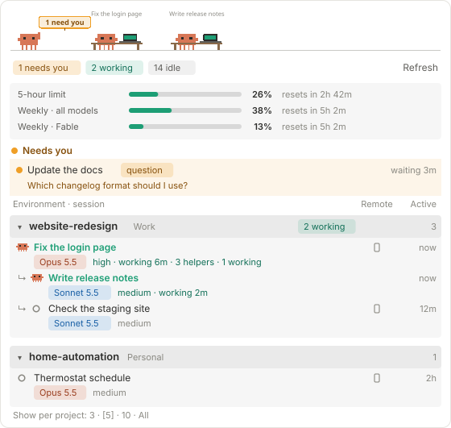
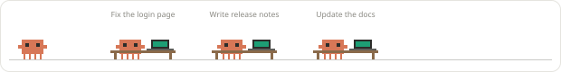
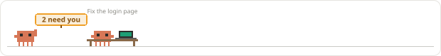
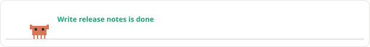

# Session Following

**See every Claude Code session at a glance, right beside your chat.**

Session Following is a mod for the Claude desktop app (Code tab). It adds a **Sessions** panel that lists every session you have open, grouped by project folder. It shows which ones are working, which are idle and which are **waiting on you**, along with each session's model, effort, context use and more. Clawd, the pixel mascot, acts out what your sessions are doing across the top.

If you run several sessions at once and lose track of them in the sidebar, this is for you.



*Example panel with made-up sessions. The pictures in this README are animated: Clawd walks and types, the green titles shimmer.*

---

## Contents

- [What you get](#what-you-get)
- [Requirements](#requirements)
- [Install](#install)
- [Using the panel](#using-the-panel)
- [Examples](#examples)
- [How "Needs you" works](#how-needs-you-works)
- [What it reads and writes](#what-it-reads-and-writes)
- [Troubleshooting](#troubleshooting)
- [Update or uninstall](#update-or-uninstall)
- [For developers](#for-developers)
- [Status and credits](#status-and-credits)

---

## What you get

**Clawd's stage (top strip)** acts out the state of all your sessions:

| What's happening | What Clawd does |
| --- | --- |
| Sessions are working | One Clawd types at a desk for each working session (up to 4, then "+N more"), with the session title above. Another Clawd strolls past. |
| Something needs you | Clawd dashes back and forth waving an amber **"N need you"** sign |
| Nothing is running | Clawd naps with floating z's, and gets up for a short walk every 30 seconds |
| A session just finished | Clawd jumps, confetti falls, and "*title* is done" appears |
| A usage limit is over 80% | Clawd sweats and fans himself |



| | |
|---|---|
|  |  |
|  |  |

**Below the stage:**

- **Counts:** pills for *need you*, *finished*, *working* and *idle*.
- **Usage table:** your 5-hour and weekly limits as bars, with percent used and time until each resets.
- **Needs you section:** pinned at the top. It shows sessions waiting for an approval or an answer, the reason, the question itself when available, and how long they've waited.
- **Finished, not seen section:** sessions that finished a task without needing you and that you haven't looked at yet, like unread messages. Each shows a blue dot, the last line of its reply and when it finished, with a **Mark all seen** button.
- **One card per project folder**, most recently active first:
  - a bold folder name, its area (for example `Personal` or `Work`) and counts
  - a fold arrow to collapse the card
  - a **"Show N more"** link when the project has more sessions than your per-project setting
- **Sub-sessions** that another session started are indented under it, and the parent shows "3 helpers · 1 working".
- **Each session row shows:**
  - a status icon: grey ring for idle, a mini Clawd for working, a pulsing amber dot for needs you, a blue dot for finished but not seen, a grey double check for finished and seen
  - the title, which shimmers green while the session works; click it to open the session
  - a coloured **model badge** (Opus, Sonnet, Fable, Haiku), the **effort** level and the **permission mode** (icon and word)
  - a **context bar** for working sessions, plus "working 4m"
  - a phone icon if **Remote Control** is on, and how long ago the session was last **active**
- **Older projects:** projects with no activity for 7+ days are folded and moved to the bottom.
- **Scratch sessions:** sessions started without a project folder (`scratch-YYYY-MM-DD-...`) share one card.
- **Key:** an explanation of every icon at the bottom.

---

## Requirements

- **The Claude desktop app** with the Code tab, on **macOS**. Clicking a title uses macOS's `open` command to jump to the session.
- **A Claude Code version that supports mods.** It was built and tested on Claude Code 2.1.317. Mods are an early-access feature, so a future app update may change how they work.
- **zsh and python3** for the install script. Both come with macOS.
- **git** to clone the repo.

---

## Install

The repo is its own plugin marketplace. Run these in a terminal:

```bash
claude plugin marketplace add Ben-Diehlci/Claude-Session-Following
```

```bash
claude plugin install session-following@claude-session-following
```

Or in the desktop app: click **+** next to the prompt box, then **Plugins**, **Add marketplace** with `Ben-Diehlci/Claude-Session-Following`, then **Add plugin**.

Then **quit and reopen the Claude app**, open a new session and type `/sessions`.

**Getting updates automatically:** run `/plugin` in a terminal session, open **Marketplaces**, pick `claude-session-following` and turn on auto-update. It's off by default for marketplaces that aren't Anthropic's. Without it, see [Update or uninstall](#update-or-uninstall).

### Install from a clone (for working on the mod)

Clone the repo, then run `./scripts/use-plugin-dir.sh` from inside it. That backs up `~/.claude/settings.json` and adds the folder to `CLAUDE_CODE_PLUGIN_DIRS`, so every session loads the mod straight from the folder and your edits reload by themselves. Use either this or the marketplace install, not both.

---

## Using the panel

### Reading a row

```
 o  Help page                          [phone]   46m
    [Opus 5.5]  medium  ⚡ auto  5 helpers
 ^  ^                                     ^        ^
 |  title (click to open)                 |        last active
 status: o idle, mini Clawd working,      Remote Control on
         amber dot needs you, blue dot finished (not seen),
         double check finished (seen)
```

### Settings and controls

| Control | Where | What it does |
| --- | --- | --- |
| **Show per project: 3 · 5 · 10 · All** | Bottom of the panel | How many sessions each project card shows. Working sessions, sessions that need you and the current session always show. Your choice is remembered across sessions. |
| **▾ / ▸** | Left of each project name | Fold or unfold that project |
| **Show N more / Show less** | Bottom of a project card | Show the rest of that project's sessions |
| **Refresh** | Top right | Refresh right away instead of waiting for the next automatic check |
| **Click a title or any text on a row** | Any session row | Opens that session in the app (and marks it seen). The icons and the model badge aren't clickable. |
| **Mark all seen** | The Finished, not seen section | Clears every blue dot at once |
| `/sessions` | The chat box | Reopens the panel if you closed it |

The panel refreshes on its own. It checks for changes every few seconds and redraws about once a minute, or sooner when something changes. It only reads sessions while the panel is open.

---

## Examples

**"Which of my sessions are still working?"**
Look at the stage: there's one typing Clawd per working session, with its title above. In the list, working sessions have a shimmering green title and a mini Clawd, and the project card header shows "1 working".

**"Did anything stop to ask me something?"**
If anything is waiting, Clawd waves a "need you" sign and an amber **Needs you** section appears at the top of the list. Each entry shows the reason, such as *permission*, *question* or *your turn*, and how long it's been waiting. Click the title to jump straight there.

**"Which sessions finished while I was away?"**
They're in the blue **Finished, not seen** section, newest first, each with the last line of its reply. Click one to open it and the dot turns into a grey double check. Reading a session from the app's sidebar without replying doesn't count as seen: click it in the panel or use **Mark all seen**.

**"Which session is close to running out of context?"**
Working sessions show a small context bar that goes green, then amber, then red as it fills.

**"How close am I to my usage limits?"**
The usage table shows your 5-hour and weekly limits, with the time until each resets. Clawd starts sweating when any limit passes 80%.

**"My long project list is in the way."**
Set **Show per project** to 3. You can also fold the busy project with ▾. Projects you haven't used in 7+ days fold at the bottom by themselves.

**"I kicked off three helper sessions from one chat."**
They appear indented under the chat that started them, and the parent row says "3 helpers · 1 working".

---

## How "Needs you" works

The desktop app doesn't report "waiting on you", so each session's own copy of the mod watches for it and leaves a small note the panel reads:

| Shown as | When |
| --- | --- |
| **permission** | A tool call is waiting for your approval and is still open after 2 seconds. Sessions in **auto** or **bypass** mode never flag this, because the app approves those on its own. |
| **question** | Claude asked you a multiple-choice question |
| **your turn** | Claude finished a turn by asking you something |

The note clears as soon as you reply, or when the session ends.

**Limits:**
- Only sessions started **after** the mod was installed (and the app restarted) can flag themselves.
- The permission mode is only reported for the current session and sessions it started, so other rows don't show a mode.
- Per-session cost isn't available from the app, so the panel doesn't show it.

---

## What it reads and writes

- **Reads:** the desktop app's own session list, session details and usage limits. These come through the app's built-in tools, on your Mac.
- **Writes:**
  - `~/.claude/session-following/waiting/<session-id>.json`, the "needs you" notes (one small file per session)
  - `~/.claude/session-following/busy/<session-id>.json`, a note a session keeps while its helper agents still work after its own reply ended, so it shows as working ("1 helper working in background")
  - `~/.claude/session-following/done/<session-id>.json`, the "finished" notes: when the turn ended, its last line, and whether you've seen it
  - `~/.claude/session-following/toasted/`, so the "is done" pop-up appears only once
  - your **Show per project** choice, in the mod's own settings store
- **Runs:** `/usr/bin/open claude://...` when you click a title.
- **Never:** sends anything over the network, reads your chats, or changes your sessions.

---

## Troubleshooting

| You see | Fix |
| --- | --- |
| No Sessions panel | Type `/sessions`. If nothing happens, run `claude plugin list` and check that `session-following` shows as enabled, then restart the app. |
| *"Couldn't read sessions: ... no connected MCP tool list_sessions"* | The panel only works in sessions the Claude desktop app runs, not in a plain terminal `claude` session. If you see it in the app, update to the latest version and restart the app. |
| A session never turns amber | It was started before the install or restart. Open a new session. |
| Amber "permission" when nothing is waiting | Reply in that session, or let its turn finish, to clear it. Please open an issue with that session's permission mode. |
| Can't scroll with the pointer over the Clawd strip | Known limit: the animated strip is its own small frame. Move the pointer below it to scroll. |
| Clicking a title does nothing | Check you're on macOS and that the session isn't archived. |

---

## Update or uninstall

**Update (marketplace install):** with auto-update on, new versions arrive by themselves. Otherwise run these, then restart the app:

```bash
claude plugin marketplace update claude-session-following
```

```bash
claude plugin update session-following@claude-session-following
```

**Update (clone):** run `git pull` in the folder. The mod reloads by itself.

**Uninstall:** run `claude plugin uninstall session-following@claude-session-following` (or, for a clone, `./scripts/remove-plugin-dir.sh`), then restart the app. You can then delete `~/.claude/session-following/`.

---

## For developers

| File | What it holds |
| --- | --- |
| `.claude-plugin/plugin.json` | Name, version and description |
| `hooks/register.tsx` | The panel: data polling, needs-you hooks, the layout |
| `hooks/stage.ts` | Clawd's stage as an SVG with SMIL animation |
| `hooks/clawd.ts` | The pixel Clawd, the pulsing dot and the usage bar |
| `hooks/shimmer.tsx` | The shimmering title (a client module) |
| `types/index.d.ts` | The shape of the mod's saved state |
| `scripts/stage-selfcheck.mjs` | Draws every stage scene and checks the SVG is well formed |
| `scripts/make-docs.mjs` | Rebuilds the animated README pictures in `docs/images/` from the real drawing code (made-up sessions) |
| `scripts/release.sh` | Publishes a new version: sets it in `plugin.json`, commits, tags, pushes and creates the GitHub release |

**Releasing an update:** installed copies only see a change once the version in `.claude-plugin/plugin.json` goes up. Commit your changes, then run (with the new version and a line on what changed):

```bash
./scripts/release.sh 0.4.2 "What changed"
```

Use the last number for fixes (0.4.1 → 0.4.2), the middle one for new features (0.4.2 → 0.5.0).

**Checks before committing:**

```bash
claude plugin validate .
```

```bash
node scripts/stage-selfcheck.mjs
```

After changing how the stage or panel looks, rebuild the README pictures:

```bash
node scripts/make-docs.mjs
```

Type-check with TypeScript 5.4+ using the `tsconfig.json` the app writes beside a loaded mod (`.claude-plugin/types/tsconfig.json`).

**Lessons learned** (details in `plan-v0.2.md`):
- `Box` sizes are **character cells**, not pixels. Only `Svg` sizes are pixels.
- Give every `Svg` a distinct, non-empty `alt`.
- Never name a variable `h` in code that draws (JSX compiles to `h(...)`).
- An image-mode `Svg` restarts its animation on every redraw. The stage uses `isInteractive`, and redraws are kept rare.
- The app sometimes replies with plain "Error ..." text instead of JSON, so parse its replies carefully.

---

## Status and credits

- **Version 0.4.0.** In daily use by its author. Mods are early access in Claude Code, so expect occasional breakage after app updates.
- **License:** [MIT](LICENSE). Use, change and share it freely; keep the copyright notice.
- **Clawd** is Anthropic's Claude Code mascot. The pixel drawings here are an unofficial fan-made version. This project isn't affiliated with or endorsed by Anthropic.
- The animated stage technique (SMIL with wall-clock offsets) follows the author's *Claude Coded Lines Tracker* mod.
